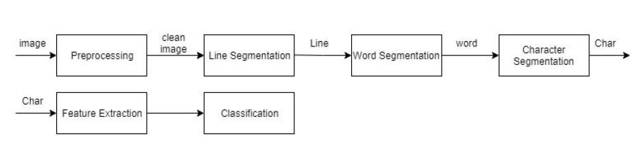
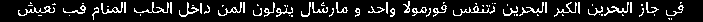
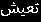
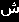
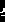
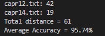

# **Arabic OCR**

  
  [](https://github.com/HusseinYoussef/Arabic-OCR/network)
  [](https://github.com/HusseinYoussef/Arabic-OCR/stargazers)
  [](https://github.com/HusseinYoussef/Arabic-OCR/blob/master/LICENSE)
  
- OCR system for Arabic language that converts images of typed text to machine-encoded text.<br>
- The system aims to solve a simpler problem of OCR with images that contain only Arabic characters (check the dataset link below to see a sample of the images).

## Important Note
> The system currently supports only letters: the 28 letters ا-ي and the لا ligature (no numbers, special symbols, ة, ى or hamza forms).
## Setup

Install Python 3.10 or newer (the code was last tested with Python 3.13), then run this command:

```shell
pip install -r requirements.txt
```

> The bundled models in `src/models` are pickles saved with an old scikit-learn (0.22). They still load with current versions, with a warning. Only load pickles you trust. If a future scikit-learn stops loading them, retrain with `python train.py` (see [Training](#training)).

## Run

1. Put the images in the src/test directory (or choose another folder with `--input`)
2. Run the following command (from any directory)
   ```shell
   python src/OCR.py
   ```
   Options: `--input DIR` (default `src/test`), `--output DIR` (default `src/output`), `-v` (log characters that could not be read).
3. The output folder will be created with:
   - text folder which has text files corresponding to the images.
   - running_time file which has the time taken to process each image.

   The output folder is generated, so it is not tracked by git.

## Pipeline



## Dataset

- Link to dataset of images and the corresponding text: [here](https://drive.google.com/open?id=1Nbp9ZXLlWV3n8yRMwj2gjs_rE6qGZU01).
- We used 1000 images to generate character dataset that we used for training.
- `Dataset/char_4K_sample.rar` in this repository is a sample of the character dataset.

## Training

All commands are run from the `src` folder.

1. Make the character images available as `Dataset/char_sample/<character>/<n>.png` (`train.py` reads that layout; check that it matches what you extract from the archive). `python dataset.py` can generate such images from the full dataset (`Dataset/scanned/*.png` with `Dataset/text/*.txt`); it writes them to `Dataset/chars`.
2. Train: `python train.py` trains all four classifiers, or name the ones you want: `python train.py 2L_NN`. Models are saved to `src/models` and their scores to `src/models/report.txt`.
3. `OCR.py` uses `src/models/2L_NN.sav`.

# Examples

## Line Segmentation



## Word Segmentation



## Character Segmentation





# Testing

**NOTE**: Make sure you have a folder with the truth output with same file names to compare it with the predicted text.

From within `src` folder run:

`python edit.py 'output/text' 'truth'`



## Automated tests

```shell
pip install -r requirements-dev.txt
pytest
```

The tests include an end-to-end run on the two sample images in `src/test` that fails if the average accuracy drops below 93% (it is currently 95.7%). They run on every push through GitHub Actions.

# Performance

- Average accuracy: 95%.
- Average time per image: 16 seconds.
- For reference, the two small sample images in `src/test` (about 340 words in total) take 0.5-0.7 seconds each on a 2-core Linux machine.

---

**NOTE**

We achieved these results when we used only the flatten image as feature.

---

# References

1. [An Efficient, Font Independent Word and Character Segmentation Algorithm for Printed Arabic Text](https://www.researchgate.net/publication/335562626_An_Efficient_Font_Independent_Word_and_Character_Segmentation_Algorithm_for_Printed_Arabic_Text).

2. [A Robust Line Segmentation Algorithm for Arabic Printed Text with Diacritics](https://www.researchgate.net/publication/317876029_A_Robust_Line_Segmentation_Algorithm_for_Arabic_Printed_Text_with_Diacritics).

3. [Arabic Character Segmentation Using Projection Based Approach with Profile's Amplitude Filter
   ](https://www.researchgate.net/publication/318205989_Arabic_Character_Segmentation_Using_Projection_Based_Approach_with_Profile's_Amplitude_Filter).
